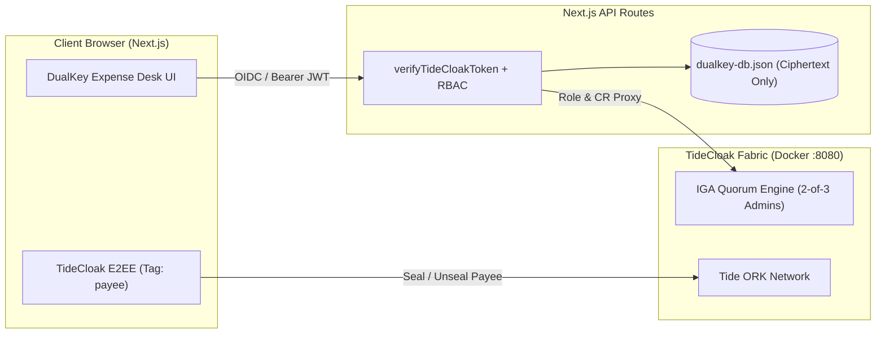

[](https://tide.org/tidecloak?utm_source=github&utm_medium=readme&utm_campaign=unlocked)

## Project overview

**DualKey Expense Desk** is a quorum-governed treasury and expense approval workspace where no single administrator, server operator, or compromised insider can unilaterally self-promote to an approver role, read beneficiary bank accounts, or release high-value funds.

Built with [TideCloak](https://tide.org/tidecloak?utm_source=github&utm_medium=readme&utm_campaign=unlocked).

### 1. Vision & originality

DualKey reimagines financial controls for NGOs, research grants, and lean enterprises where the person running IT infrastructure often co-exists with financial operations. Instead of trusting a super-admin not to abuse database or IAM access, DualKey separates *system administration* from *financial authority* using Emergent Authority.

### 2. Trust constraint insight

In conventional expense systems, "dual approval" is fragile: a compromised IT administrator or Identity Provider operator can silently assign themselves the `expense-approver` role or tamper with payee bank details in the database. Removing unilateral administrative override makes true multi-party financial custody possible without enterprise hardware security modules.

### 3. Value & impact

Humanitarian NGOs and community treasuries frequently lose donor trust—or suffer devastating Business Email Compromise (BEC) payouts—because one compromised admin account can rewrite access rules and redirect wire transfers. With DualKey, donors and boards gain mathematical assurance that no lone insider can manufacture approval authority or expose beneficiary banking coordinates.

### 4. Why TideCloak matters

DualKey relies on three TideCloak capabilities that ordinary auth cannot provide:
- **IGA Quorum Governance (2-of-3 Admins):** Assigning `expense-approver` generates a governed change request (`/iga/change-requests`) requiring 2 of 3 admin signatures (`floor(3 × 0.7) = 2`). A lone admin cannot self-promote.
- **Role-Bound E2EE (`payee` tag):** Beneficiary bank coordinates (BSB/Account/SWIFT) are sealed so only `expense-approver` holders can unseal them; raw database dumps yield ciphertext only.
- **Server-Side JWT & Role Verification:** Every approval and disbursement endpoint independently verifies TideCloak tokens and roles.

### 5. Prototype & storytelling

Judges can experience a four-actor workflow (`Dave` Submitter, `Alice` Rogue IT Admin, `Bob` Finance Approver 1, `Carol` CFO Approver 2):
1. **Dave** submits an **$18,500 AUD** clinic solar microgrid expense with E2EE-sealed payee bank details.
2. **Alice (IT Admin 1/3)** attempts to grant herself `expense-approver`—TideCloak IGA intercepts and parks the mutation as `PENDING (1/2 Quorum)`, blocking her approval (`403`), self-commit (`409`), and payee decryption (`403`).
3. **Bob** and **Carol** decrypt the payee coordinates, sign the 1st and 2nd approvals, and release the payment.

---

## Architecture & Scope Transparency



- **Enforced by TideCloak:** Zero-knowledge OIDC authentication, IGA Change-Request Quorum (`POST /admin/realms/dualkey/users/{id}/role-mappings/realm` -> parked in `/iga/change-requests` until 2-of-3 admin quorum), and E2EE tag-based protection (`_tide_payee.selfencrypt` / `_tide_payee.selfdecrypt`).
- **Enforced by DualKey Server Policy:** Dual-control disbursement threshold (`>= $10,000 AUD` requires 2 distinct `expense-approver` signatures) and separation of duties (submitter cannot self-approve).
- **Next Step (Post-Hackathon):** Binding the final payment release instruction to a custom C# Forseti signing contract deployed on the Tide ORK network (`PolicySignRequest`) so the payment rail itself verifies a threshold Ed25519 signature.

---

## Setup

### Prerequisites
- **Docker Desktop** running locally
- **Node.js 20.9+**

### 1. Start TideCloak Dev Server
```bash
docker run --name mytidecloak -d -p 8080:8080 \
  -e KC_BOOTSTRAP_ADMIN_USERNAME=admin \
  -e KC_BOOTSTRAP_ADMIN_PASSWORD=password \
  tideorg/tidecloak-dev:latest
```

### 2. Provision the `dualkey` Realm & Actors
```bash
npm install
node scripts/provision-tidecloak.mjs
```
This script provisions the `dualkey` realm, enables IGA Quorum Governance, creates the demo actors (`dave`, `alice`, `bob`, `carol`), grants `expense-approver` only to `bob` and `carol` (leaving `alice` without approver authority), and writes `tidecloak.json`.

### 3. Start the Prototype
```bash
npm run dev
```
Open **http://localhost:3000** to explore the interactive 4-actor demo and run the automated smoke test:
```bash
node scripts/smoke-test.mjs
```

