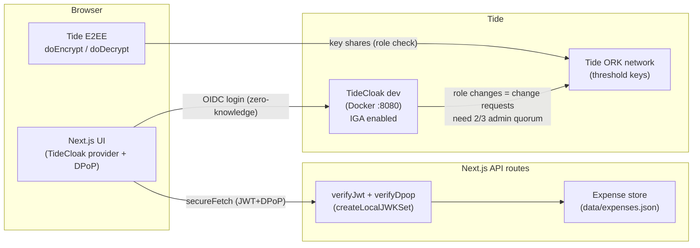
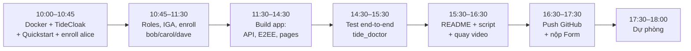

# DualKey Expense Desk — Kế hoạch cho UNLOCKED (Tide · RMIT Challenge 2)

## Mục tiêu

Làm một prototype nhỏ nhưng **chạy được, có tích hợp TideCloak**: một app duyệt chi tiêu giá trị cao. Ý chính để demo:

> **Không một admin nào, kể cả IT admin có toàn quyền server/DB, có thể một mình tự biến mình thành người duyệt chi, tự duyệt khoản chi, hay đọc thông tin ngân hàng của người nhận.**

Vì sao app này không làm được với login thường: trong hệ thống bình thường, admin chỉ cần sửa role trong DB/IdP là thành approver. TideCloak (IGA quorum + E2EE theo role) khiến việc đó **về mặt mật mã không thể làm một mình**.

**Hạn nộp: 18:00 hôm nay (22/10, giờ Việt Nam)** · Nộp: repo GitHub public (code + README + video `.mp4` 2 phút) → [Google Form](https://forms.gle/HRHYjnqB86j1LFS97)

### Tiêu chí chấm (README phải trả lời đúng 5 mục này, ≤300 từ)
| % | Tiêu chí | Câu trả lời của mình |
|---|---|---|
| 25 | Vision & originality | Duyệt chi "hai chìa khoá" cho startup/NGO/hội nhóm, nơi quyền lực về tiền nằm trong tay vài người |
| 20 | Trust constraint insight | Gian lận nội bộ / BEC: admin bị chiếm tài khoản tự cấp quyền approver hoặc sửa số tài khoản người nhận |
| 20 | Value & impact | Ví dụ: NGO nhỏ, kế toán kiêm IT admin; nhà tài trợ tin được rằng không ai một mình rút tiền được |
| 20 | Why TideCloak matters | IGA quorum (2/3 admin) bảo vệ role approver; E2EE: chỉ role approver giải mã được thông tin ngân hàng; DPoP + JWT xác minh ở server |
| 15 | Prototype & storytelling | Video demo 4 cảnh (xem bên dưới) |

---

## Cần bạn xem

> [!IMPORTANT]
> **Những việc chỉ bạn làm được** (mình không được làm thay):
> 1. **Cài Docker Desktop** và bật lên (cần trước 10:45 nếu được).
> 2. **Email quản lý licence Tide + đồng ý Terms & Conditions** tại https://tide.org/legal. Bootstrap sẽ không chạy nếu thiếu `TIDE_LICENSE_EMAIL` và `TIDE_TERMS_ACCEPTED=yes`.
> 3. **Hoàn tất Tide enrollment** trên trình duyệt cho **4 tài khoản** (mỗi tài khoản vài phút, qua link invite):
>    - `alice`: IT Admin (vai "admin cố vượt quyền" trong demo)
>    - `bob`: Admin + Finance Approver
>    - `carol`: Admin + CFO Approver
>    - `dave`: nhân viên gửi đề nghị chi
> 4. **Quay video**, tạo repo GitHub public, nộp Google Form.

> [!WARNING]
> **Giới hạn kỹ thuật cần trung thực trong README:**
> - Quorum IGA do TideCloak tính: `max(1, floor(số_admin × 0.7))`. **3 admin → cần 2 chữ ký**. Với 2 admin thì 1 người vẫn tự commit được, nên bắt buộc phải có 3 admin.
> - Quy tắc "khoản > \$10,000 cần 2 approver khác nhau" là **logic của app** (kiểm tra ở server với JWT đã xác minh). Thứ TideCloak bảo vệ bằng mật mã là: **ai được làm approver** (quorum) và **ai đọc được thông tin ngân hàng** (E2EE).
> - Ký giao dịch bằng Forseti contract (ORK ký lệnh chuyển tiền theo policy) cần Tide team deploy, nên **không làm trong hackathon**. Mình sẽ đưa vào phần "Next step" của README.

## Câu hỏi còn mở

> [!IMPORTANT]
> - Tên dự án: mình đề xuất **"DualKey"**. Bạn muốn tên khác không?
> - Repo sẽ khởi tạo **ngay trong workspace hiện tại** (`GenAI-Hackathon-2026`). Bạn đã có remote GitHub chưa, hay sẽ tự tạo repo rồi đưa mình URL?
> - Đội của bạn có mấy người? Nếu có người khác, một người có thể làm enrollment tài khoản/viết kịch bản song song trong lúc mình code.

---

## Kiến trúc



**Luồng dữ liệu nhạy cảm:** thông tin ngân hàng người nhận (BSB/số TK) được **mã hoá ngay trên trình duyệt** của Dave bằng Tide E2EE với tag `payee`. Server/DB chỉ lưu ciphertext. Chỉ người có role `expense-approver` mới được ORK cấp key share để giải mã. Alice (admin, có quyền DB) chỉ thấy chuỗi mã hoá.

### Roles (TideCloak client roles)
| Role | Ai | Quyền |
|---|---|---|
| `expense-submitter` | dave | Tạo đề nghị chi, mã hoá payee |
| `expense-approver` | bob, carol | Duyệt, giải mã payee |
| `tide-realm-admin` (realm-management) | alice, bob, carol | Đề xuất/ký change request IGA |

---

## Thay đổi đề xuất

Thứ tự: hạ tầng trước, rồi auth, data, UI, cuối cùng là tài liệu.

### 1. Hạ tầng TideCloak (theo Quickstart + playbooks Raziel)

- `docker run --name mytidecloak -d -v .:/opt/keycloak/data/h2 -p 8080:8080 -e KC_BOOTSTRAP_ADMIN_USERNAME=admin -e KC_BOOTSTRAP_ADMIN_PASSWORD=password tideorg/tidecloak-dev:latest`
- `npm.cmd init @tidecloak/nextjs@latest dualkey`: tự tạo realm, license, IGA, first admin. **Bạn mở link "ACTION REQUIRED" để enroll alice.**
- Dùng `npm.cmd` thay `npm` vì PowerShell đang chặn `npm.ps1`.
- Mình sẽ gọi Raziel MCP qua HTTP (đã kiểm tra chạy được) để lấy đúng các playbook: `add-rbac-nextjs`, `protect-api-nextjs`, `verify-jwt-server-side`, `setup-forseti-e2ee`, `configure-e2ee-roles-and-policies`, `setup-iga-admin-panel`, cộng `tide_doctor` để tự kiểm tra.

### 2. App Next.js (trên template Quickstart)

#### [NEW] `lib/auth/verify.ts`
Verifier cho server: JWT (`createLocalJWKSet(tidecloak.json.jwk)`) + DPoP proof + kiểm tra role trong `resource_access`. Copy từ `.tide-pack/templates/dpop-verify/verifyDpop.ts`, không tự viết lại.

#### [NEW] `lib/store.ts`
Lưu trữ JSON file (`data/expenses.json`, dữ liệu giả lập):
```ts
type Expense = {
  id: string; title: string; amountAud: number; submitterSub: string;
  payeeCiphertext: string;          // Tide E2EE, tag "payee"
  receiptNote: string;
  approvals: { sub: string; name: string; at: string }[];
  status: "PENDING" | "APPROVED" | "PAID" | "REJECTED";
  audit: { at: string; actor: string; action: string; ok: boolean; reason?: string }[];
};
const THRESHOLD_AUD = 10_000; const REQUIRED_APPROVALS = 2;
```

#### [NEW] `app/api/expenses/route.ts`: `GET` danh sách, `POST` tạo (yêu cầu `expense-submitter`)
#### [NEW] `app/api/expenses/[id]/approve/route.ts`
- Bắt buộc JWT + DPoP hợp lệ **và** role `expense-approver` (kiểm tra ở server, không tin UI)
- Từ chối nếu `sub` = người gửi (không được tự duyệt) hoặc `sub` đã duyệt rồi
- Đủ 2 approver khác nhau → `APPROVED`; mọi lần thử (kể cả thất bại) đều ghi vào audit log
#### [NEW] `app/api/expenses/[id]/release/route.ts`: "Release payment" giả lập (mock payment rail)
#### [NEW] `app/api/governance/*`: proxy server-side tới `/iga/change-requests` dùng **token của chính admin** (không dùng master credentials, theo AP-G07/G08)

#### [NEW] Pages
| Trang | Nội dung |
|---|---|
| `/submit` | Dave tạo đề nghị chi; trường payee được mã hoá trên trình duyệt trước khi gửi |
| `/expenses` | Danh sách + chi tiết; nút "Decrypt payee" (chỉ chạy được với approver); thanh tiến trình duyệt (1/2, 2/2) |
| `/governance` | Danh sách change request đang chờ; admin bấm Approve (qua popup enclave Tide) |
| `/admin-console` | **Cảnh "tấn công"**: Alice bấm "Grant myself expense-approver" → tạo change request **PENDING**; Alice thử duyệt → 403; xem DB raw → chỉ thấy ciphertext |
| `/audit` | Audit log: ai làm gì, lúc nào, thành công hay bị chặn |

UI: Tailwind có sẵn trong template, làm gọn và sạch. Mỗi màn hình có banner "Who am I / my roles" để video dễ theo dõi.

### 3. Tài liệu & nộp bài

#### [NEW] `README.md`
Badge "Built with TideCloak" + `## Project overview` (1 câu mô tả + 5 mục theo template của ban tổ chức, ≤300 từ) + `## Setup` (riêng) + `## Limitations & next steps` + link video.
#### [NEW] `docs/demo-script.md`: kịch bản quay theo từng giây
#### [NEW] `demo.mp4`: bạn quay (Xbox Game Bar `Win+G` hoặc OBS), < 100 MB
#### [MODIFY] `.gitignore`: loại `.tide-pack/`, `data/*.h2*`, `.env*`, `node_modules`

### Kịch bản video 2 phút (dàn ý)
| Thời gian | Cảnh | Nội dung |
|---|---|---|
| 0:00–0:20 | **The possibility** | "Một NGO nhỏ: IT admin cũng giữ chìa khoá tài chính. DualKey: không ai một mình di chuyển được tiền." |
| 0:20–0:40 | **The constraint** | Hệ thống thường: admin sửa 1 dòng role là thành approver, đổi số TK người nhận, chuyển tiền |
| 0:40–1:30 | **The prototype** | Dave gửi khoản \$18,500 (payee được mã hoá) → Alice tự cấp quyền approver → **PENDING, cần 2/3** → Alice duyệt → **403** → Alice xem DB → ciphertext → Bob duyệt (1/2) + giải mã payee → Carol duyệt (2/2) → Release |
| 1:30–2:00 | **What changes** | Audit log; "nhà tài trợ/kiểm toán tin hệ thống mà không cần tin admin" |

---

## Lịch làm việc (còn ~8 tiếng)



> [!CAUTION]
> **Phương án dự phòng nếu E2EE hoặc IGA multi-admin bị lỗi lúc 14:30:** giữ phần đã chạy (login TideCloak + role approver xác minh ở server + change request pending), quay video với phần đó, và mô tả trung thực trong README. **Mốc cứng: 16:30 bắt đầu quay video, dù đã xong hết hay chưa.**

---

## Kế hoạch kiểm tra

### Tự động
- `tide_doctor` (qua Raziel MCP) chạy đến khi `RESULT: OK`, rồi chạy lại với `--url http://localhost:3000`
- `npm.cmd run build`: build phải thành công, không lỗi type
- Script `scripts/smoke.ps1`: gọi API **không token / token không có role** và kiểm tra trả về `401/403`

### Kiểm tra thủ công (theo đúng kịch bản video)
1. Dave login → tạo khoản \$18,500 → `data/expenses.json` chỉ chứa ciphertext cho payee
2. Alice "grant myself approver" → change request ở trạng thái PENDING, token của Alice không có role → approve trả 403
3. Bob approve change request khác (ví dụ) → xác nhận cần chữ ký thứ 2 mới commit
4. Bob duyệt (1/2), giải mã được payee; Dave không giải mã được
5. Bob duyệt lần 2 → bị chặn (trùng người); Carol duyệt → APPROVED → Release → PAID
6. Audit log hiển thị đủ các lần thử, cả thành công lẫn bị chặn
